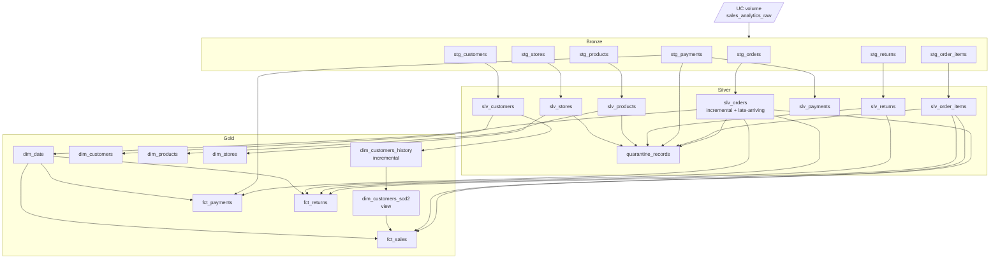

# Architecture

## 1. Purpose and scope

`sales_analytics` turns seven raw CSV extracts (orders, order items, customers,
products, stores, payments, returns) into a query-ready star schema in Unity
Catalog.

**In scope**

- Ingestion from a UC volume into Delta tables
- Cleaning, standardisation, deduplication
- Data-quality quarantine
- Type-2 customer history
- Conformed dimensions and three fact tables
- Environment isolation (dev/prod) and scheduled orchestration

**Out of scope**

- Source-system extraction (files are dropped into the volume by an upstream
  process)
- Real-time/streaming ingestion (the project is batch)
- BI semantic models (Power BI/Tableau live downstream)

## 2. Layer responsibilities

| Layer | Schema | Materialisation | Responsibility | Rule of thumb |
|---|---|---|---|---|
| Bronze | `bronze` | `table` | Faithful copy of the source, plus lineage columns | Never drop or reinterpret a row |
| Silver | `silver` | mostly `table`, one `incremental` | Types, canonical values, dedupe, quarantine | One row per business key, clean |
| Gold | `gold` | `table`, one `view` | Star schema, conformed keys, business logic | Optimised for BI queries |

### Bronze

Each `stg_*` model calls Databricks `read_files()` against the volume with
`inferColumnTypes => false`. Every source column therefore lands as `STRING`,
which makes ingestion resilient to schema drift and dirty values (e.g. `Rs.
1,299` in a numeric column). Two audit columns are appended:

- `_ingest_ts` — `current_timestamp()` at read time
- `_source_file` — the exact volume path read

Bronze models are full-refresh tables. They are cheap, deterministic, and act
as the replayable landing zone.

### Silver

Silver models do the actual data work:

- **Typing** — `parse_date`, `parse_timestamp`, `clean_amount`, `to_boolean`
- **Standardisation** — `normalize_text`, `map_values` for statuses/methods/reasons
- **Deduplication** — `row_number() over (partition by <key> order by <recency>)`
- **Late-arriving reconciliation** — `slv_orders` is incremental and merges
- **Quarantine** — `quarantine_records` records every failed invariant

`slv_*` models are the contract for gold: stable column names and types, one
row per key.

### Gold

Gold is a star schema:

- Dimensions: `dim_customers`, `dim_customers_scd2`, `dim_products`,
  `dim_stores`, `dim_date`
- Facts: `fct_sales`, `fct_payments`, `fct_returns`

`dim_customers_history` is a supporting incremental table, and
`dim_customers_scd2` is a view over it.

## 3. Data flow



`quarantine_records` reads silver models and is therefore a sibling of gold,
not a parent. It does not block the gold build.

## 4. Key design decisions

### 4.1 Read CSV with `inferColumnTypes => false`

Databricks' CSV inference guesses types from the first rows. Because the source
contains currency strings, mixed date formats and blank numerics, inference
would either fail or produce inconsistent types between runs. Reading
everything as `STRING` makes bronze deterministic and pushes all type decisions
into version-controlled silver macros.

### 4.2 Table vs incremental

- **Bronze**: always `table`. The volume is the source of truth; a full read is
  cheap at this scale and guarantees no drift.
- **Silver**: `table` where a full rebuild is cheap and logic is set-based
  (customers, products, stores, items, payments, returns). `slv_orders` is
  `incremental` because it demonstrates the late-arriving merge pattern.
- **Gold**: `table` for BI performance. `dim_customers_scd2` is a `view`
  because its validity windows must be recomputed whenever history changes.

### 4.3 Late-arriving window

On each incremental run we want more than "rows newer than the watermark" —
backfills and CDC retries can arrive with an older `last_modified_at`. The
window re-reads `max(watermark) - N days`:

```sql
with {{ late_arriving_window('last_modified_at') }},
incoming as (
    select ... from parsed
    cross join late_arriving_window
    where last_modified_at >= window_start
)
```

**Why a CTE and not a subquery?** Databricks rejects aggregate scalar
subqueries in `WHERE` (`INVALID_WHERE_CONDITION`). Exposing the watermark as a
one-row CTE and `cross join`-ing it is both valid and easier to read.

**Why `reconcile_with_target`?** Re-reading a window means an old row can come
back after a newer row is already stored. The macro unions incoming rows with
matching target rows and keeps the newest per key:

```sql
row_number() over (partition by order_id order by last_modified_at desc, _ingest_ts desc)
```

This makes the merge **idempotent and monotonic**: replaying the same window
produces the same result, and a late older row never overwrites a newer one.

The lookback is configurable per run via the `late_arriving_lookback_days` var
(default 3). Widen it for older backfills.

### 4.4 SCD2 as insert-only history + windowed view

Two objects cooperate:

1. **`dim_customers_history`** — incremental, `merge` on
   `(customer_id, valid_from)`, where `valid_from = updated_at` from the source.
   It only ever inserts versions; it never closes a row.
2. **`dim_customers_scd2`** — a view that computes
   `lead(valid_from) as valid_to`, `is_current`, `version_number` and
   `customer_sk = md5(customer_id || valid_from)`.

Why this shape:

- **Late-arriving versions need no UPDATE.** If an older `updated_at` arrives
  after a newer one, the view simply re-derives the windows. A classic
  close-out UPDATE would have to find and patch the predecessor row.
- **Idempotent.** The merge key is the natural version key, so re-running is a
  no-op.
- **Auditable.** History is append-only; you can see exactly which source
  versions were observed and when (`_loaded_at`).

`dim_customers` remains a Type-1 current-state table for simple operational
reporting.

### 4.5 As-of joins with an earliest-version fallback

`fct_sales` must attribute an order to the customer attributes valid **at order
time**, not today:

```sql
left join dim_customers_scd2 c
  on c.customer_id = o.customer_id
 and o.order_date >= c.valid_from
 and o.order_date <  c.valid_to
```

Some orders predate the first version ever observed for their customer (the
dataset only captures recent `updated_at` values). A strict as-of join would
leave those rows with a NULL key. The model therefore falls back to the
customer's **earliest** version, and finally to the `'UNKNOWN'` sentinel:

```sql
coalesce(as_of.customer_sk, first_version.customer_sk, 'UNKNOWN')
```

The fallback never attributes an order to a *later* state, so historical
accuracy is preserved. Current result: 43 of 2,957 order lines (1.45%) are
`UNKNOWN` — these are orders whose `customer_id` does not exist in the
customer extract at all.

### 4.6 Environment isolation by catalog

Dev and prod share a workspace but not storage:

- `dev` → catalog `dbt`
- `prod` → catalog `dbt_prod`

Because `generate_schema_name` returns the custom schema name as-is, models land
in `<catalog>.bronze`, `<catalog>.silver`, `<catalog>.gold` in both
environments. Promotion is therefore a target switch, not a code change.

### 4.7 Documentation persistence

`dbt_project.yml` enables `+persist_docs` for relations and columns, so model
and column descriptions from `schema.yml` are written to Unity Catalog as table
and column comments. This makes the catalog itself self-documenting for
consumers who never open the dbt repo.

### 4.8 Logging and observability

Logging has two sinks: greppable console/log lines and a Delta audit table.
Both are wired in `dbt_project.yml`:

```yaml
on-run-start:
  - "{{ create_audit_schema() }}"
  - "{{ create_audit_table() }}"
  - "{{ log_run_start() }}"
on-run-end: ["{{ log_run_end(results) }}"]

models:
  sales_analytics:
    +pre-hook:  "{{ log_model_start() }}"
    +post-hook: "{{ log_model_end() }}"
```

**Three levels**

| Level | Emitted by | Audit row | Example |
|---|---|---|---|
| Run | `on-run-start` / `on-run-end` | `run_start` / `run_end` | `run=end total=98 success=93 warn=5 error=0` |
| Model | project-level pre/post hooks | `start` / `end` | `model=fct_sales step=end ... schema=gold` |
| Step | inline `{{ log_step('...') }}` | one row per step | `model=slv_orders step=reconcile detail=late-arriving window` |

**Design details**

- Each console line is a stable, greppable key/value record prefixed with
  `[sales_analytics]`.
- `log_step` prefers `this.schema` / `this.database` so the log shows where the
  data actually lands (`gold`), not the profile default (`dev`).
- All logging is wrapped in ``. dbt renders hooks once during
  parsing; without the guard every model would log before the run starts.
- Model start/end hooks return `INSERT` statements. The `end` row computes
  `rows_read`, `rows_written` and `content_hash` in SQL against the just-built
  relation.
- Inline steps are written with `run_query()` while the model compiles. They are
  additionally gated on `flags.WHICH in ('run', 'build')`, so `dbt parse` and
  `dbt compile` never mutate the audit table.
- Hooks apply to models. Snapshots and tests are covered by the run-level
  summary.

**Following a run**

```powershell
dbt build --profiles-dir . 2>&1 | Select-String '\[sales_analytics\]'
```

The same lines are written to `logs/dbt.log`, so a CI artifact captures the
full model/step timeline.

### 4.9 Audit metrics and idempotency

Every model `end` row stores:

| Column | Meaning |
|---|---|
| `rows_read` | Sum of the direct parents' row counts. Source-less models (bronze `read_files`, `dim_date`) fall back to their own count. |
| `rows_written` | `count(*)` of the model relation after materialisation. |
| `content_hash` | `sum(hash(...))` over stable business columns. |

`content_hash` deliberately excludes volatile audit columns: `_ingest_ts`,
`_loaded_at`, `detected_at` and anything prefixed `dbt_`. Without this, a
full-refresh table would hash differently on every run simply because its
ingestion timestamp changed.

Two views make the table usable:

- **`observability.pipeline_step_timeline`** — orders each model's events
  `start → inline steps → end` (phase 1/2/3) and attaches the model's
  `rows_read` / `rows_written` to every step. Inline steps are physically
  inserted during compilation, so `logged_at` alone would sort them before
  `start`; the phase column fixes the logical order.
- **`observability.idempotency_check`** — compares the latest two successful
  `end` rows per model. `is_idempotent` is true when both the row count and the
  content hash are unchanged. `NULL` means only one run has been observed.

The audit table itself is created by hooks, not by a dbt model, because the
pre/post hooks must append to it before and after each model. It is exposed to
the dbt graph as a source (`models/observability/sources.yml`).

Current dev result after two consecutive builds: **24/24 pipeline models
idempotent, `row_delta = 0`**. Observability models are excluded from the
comparison because their output changes as the log grows.

## 5. Naming conventions

| Object | Prefix | Example |
|---|---|---|
| Bronze model | `stg_` | `stg_orders` |
| Silver model | `slv_` | `slv_orders` |
| Dimension | `dim_` | `dim_products` |
| Fact | `fct_` | `fct_sales` |
| Audit column | `_` | `_ingest_ts`, `_loaded_at`, `_source_file` |
| Surrogate key | `_sk` | `customer_sk` |
| Date dimension key | `date_key` | `20260131` (integer `yyyyMMdd`) |

Tags mirror the layer (`bronze`, `silver`, `gold`) plus the domain
(`orders`, `customers`, …), so `--select tag:gold` or `--select tag:orders`
both work.

## 6. Extension points

- **New source file** — add `stg_<name>` reading the volume, then `slv_<name>`,
  then a gold model. Add tests in the matching `schema.yml`.
- **New DQ rule** — add a `union all` branch to `quarantine_records.sql` with a
  new `reject_reason`, then document it in `docs/DATA_QUALITY.md`.
- **Auto Loader** — replace `read_files()` in bronze with a streaming
  `cloud_files()` table when ingestion volume grows; silver/gold are unaffected.
- **dbt platform** — adding a licence enables `dbt docs generate` and
  column-level lineage.
